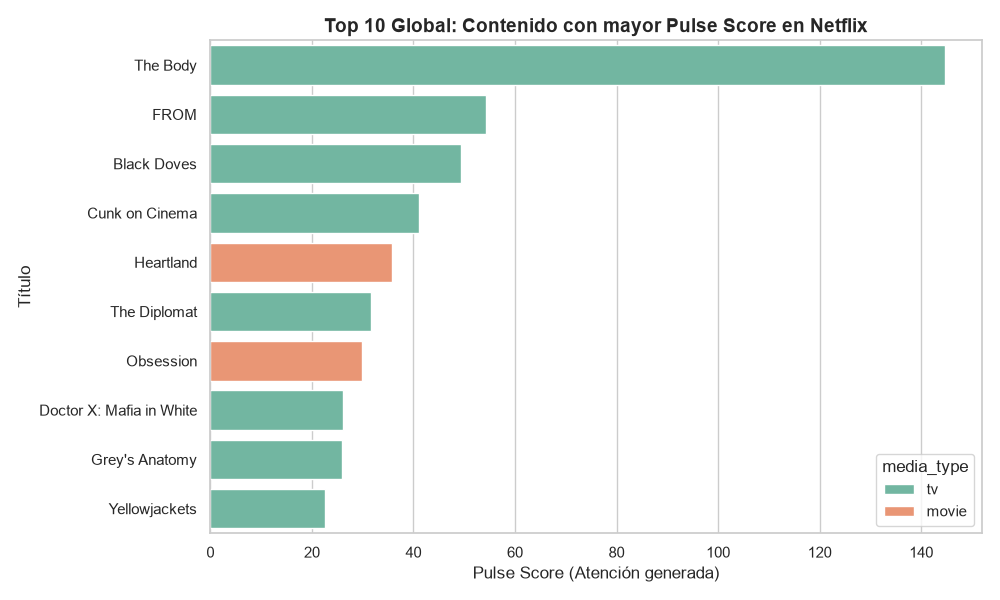

# 📺 Análisis de Tendencias de Netflix (W2TCH Pulse)

Este repositorio contiene un Análisis Exploratorio de Datos (EDA) sobre el catálogo y la popularidad de Netflix, basado en el dataset público **W2TCH Netflix Pulse**.

## 🎯 Objetivo de Negocio
Determinar qué tipo de contenido está captando mayor atención en la plataforma y comparar el posicionamiento estratégico de la plataforma (Platform Rank) frente al interés real de los usuarios (Pulse Score).

## 🛠️ Herramientas Utilizadas
*   **Python 3**
*   **Pandas** (Limpieza y manipulación de datos)
*   **Matplotlib / Seaborn** (Visualización de datos)
*   **Jupyter Notebooks** (Análisis interactivo)

## 🔍 Hallazgos Clave (Insights)
1.  **El Reinado de las Series:** A pesar de que las películas ocupan los primeros puestos en el ranking de la plataforma, las series generan casi **5 veces más atención** (Pulse Score promedio: 16.57 vs 3.19 de las películas).
2.  **Fenómeno Viral:** El contenido *The Body* (serie) lidera de forma abrumadora el interés global con un Pulse Score de **144.74**, más del doble que el segundo lugar.
3.  **Diferencia de Estrategia:** La plataforma tiende a impulsar películas nuevas (*Heartland*) en el primer puesto de visualización, mientras que las series sostenidas (*The Diplomat*, *FROM*) dominan la conversación global real.
4.  **Datos Faltantes:** Se identificó un pequeño porcentaje de valores nulos en identificadores externos (`imdb_id`, `wikidata_id`), aunque el 100% de las filas cuenta con título y puntuación.

## 📊 Visualización

## 📂 Estructura del Proyecto
*   `data/`: Dataset original en formato CSV.
*   `notebooks/`: Jupyter Notebook con el análisis paso a paso.
*   `outputs/`: Gráficos e imágenes generadas.

## 👩‍💻 Autora
**DJimenez71** - *Estudiante de Administración de Sistemas* 
[Mi GitHub](https://github.com/DJimenez71)

## 📝 Fuente de los Datos
*   Dataset: [W2TCH Netflix Pulse](https://www.kaggle.com/datasets/davidmorgan223/w2tch-netflix-pulse)
*   Licencia: CC BY 4.0

*Análisis realizado por Daniela Jimenez como parte de mi portafolio de análisis de datos deportivos.*
*18 de noviembre de 2026*